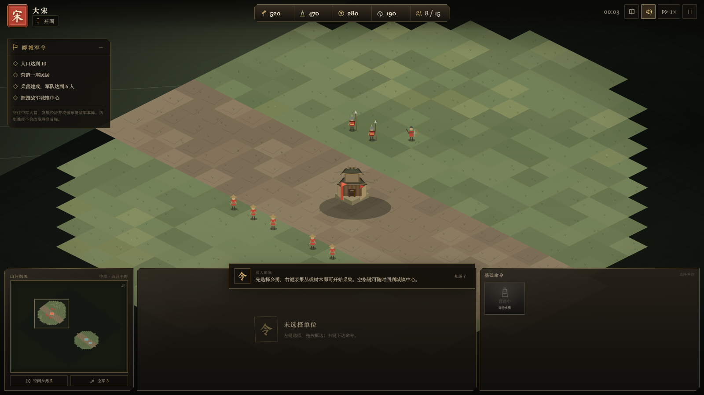
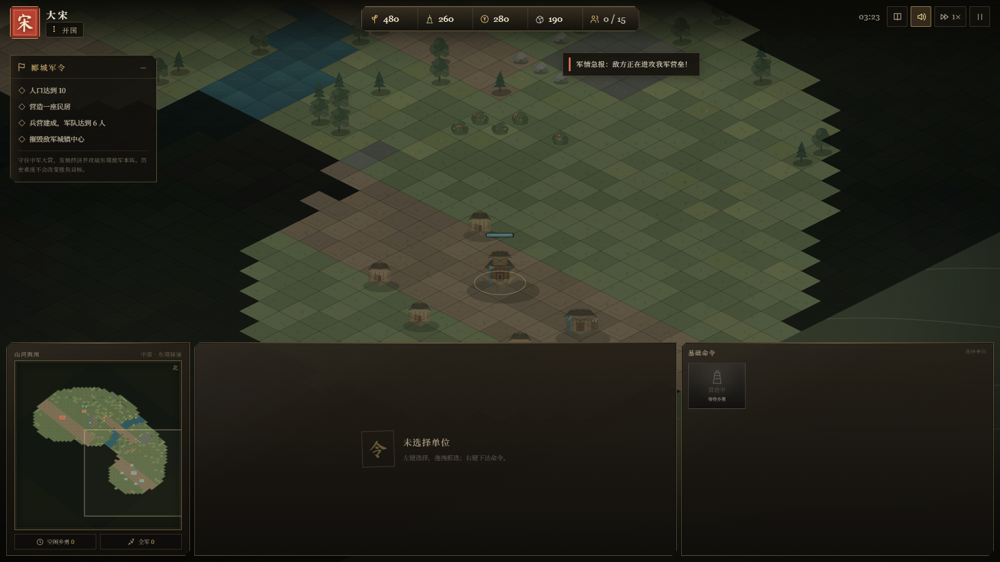
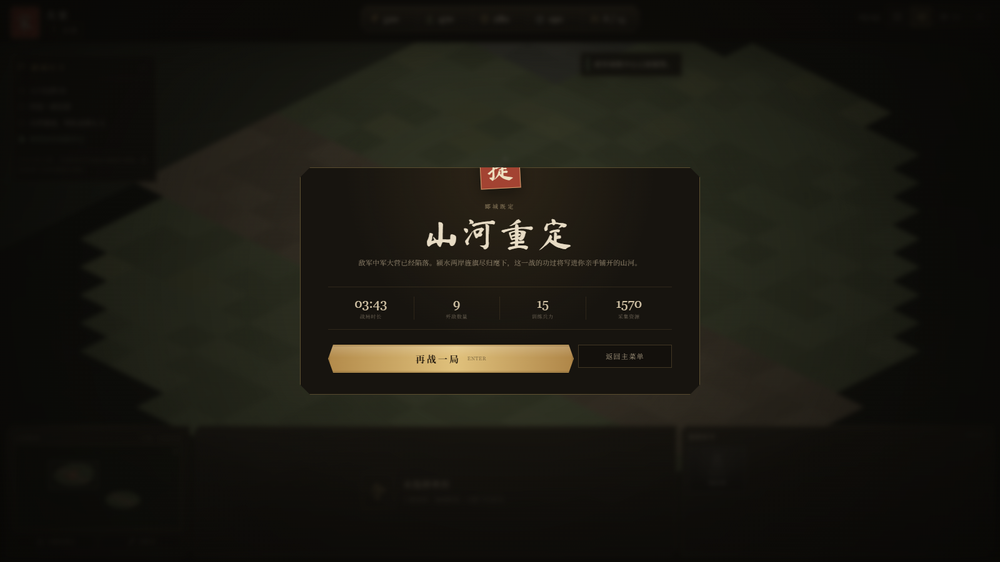
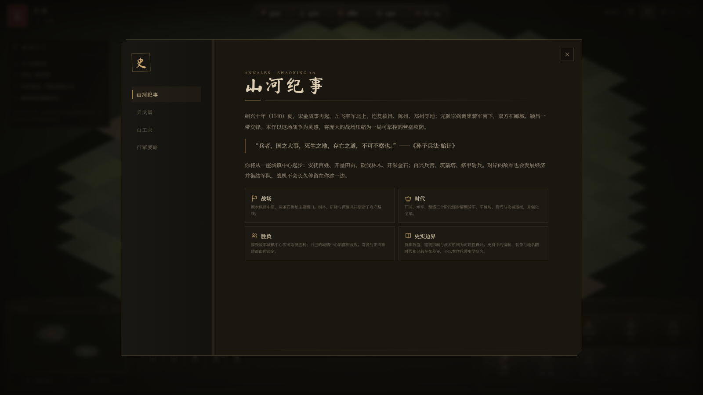

# Banners of the Realm

### 山河烽烟 · 宋金风云

[](https://github.com/ZhuangHT-1201/banners-of-the-realm/actions/workflows/deploy-pages.yml)
[](LICENSE)
[](package.json)

An open-source, single-player browser RTS set during the Song–Jin War of 1140. Build a stronghold, gather resources, advance through three eras, and command armies across a stylized Central Plains battlefield.

一款可直接在浏览器中游玩的单机即时战略游戏。以绍兴十年（1140）宋金郾城之战为历史舞台，在虚构化战场上经营城邦、推进时代、编成军队并攻破敌营。

**[Play in your browser](https://ZhuangHT-1201.github.io/banners-of-the-realm/)** · **[View source on GitHub](https://github.com/ZhuangHT-1201/banners-of-the-realm)**

<p align="center">
  
</p>

## Gameplay / 玩法

- **Three ages and four resources**: food, wood, gold, and stone support a full economy-to-army progression.
- **A complete economy loop**: villagers gather and carry resources; farms, lumber camps, mills, and mining camps keep production moving.
- **Eleven buildings and five unit types**: build housing, barracks, archery ranges, stables, forges, towers, and siege weapons.
- **Real-time command**: drag-select, Shift-add, contextual right-click orders, attack-move, control groups, and rally points.
- **Fog of war and enemy AI**: explore the map while an opposing commander expands, researches, advances eras, and launches attacks.
- **Two factions**: Song bonuses favor economy and archery; Jin bonuses favor mobile armored cavalry.
- **Generated presentation**: Canvas 2D art, animated water and smoke, combat effects, a minimap, procedural sound, and an in-game historical codex.

| Battlefield | Enemy assault |
| --- | --- |
|  |  |

<p align="center">
  
</p>

The in-game **Historical Codex** explains the Song–Jin setting, factions, units, economy, and controls without leaving the battlefield.

<p align="center">
  
</p>

## Play Locally

Requirements: Node.js 20 or newer.

```powershell
npm install
npm run dev
```

Vite opens `http://127.0.0.1:5173/rts.html`. If the browser does not open automatically, visit that URL.

Create a production build with:

```powershell
npm run build
npm run preview
```

The built entry is `dist/rts.html`.

Run the camera regression tests with:

```powershell
npm test
```

## Controls

| Action | Input |
| --- | --- |
| Pan camera | `WASD` / arrow keys / middle-drag / screen edge |
| Zoom | Mouse wheel |
| Select / box-select | Left click / left drag |
| Add to selection | `Shift` + left click |
| Move / gather / attack | Right click |
| Attack-move | `A`, then left click |
| Stop | `S` |
| Return to town center | `Space` |
| Select entire army | `Ctrl + A` |
| Control groups | `Ctrl + 1–9` to set, `1–9` to recall |
| Next idle villager | `.` |
| Pause | `Esc` |
| Codex and controls | `F1` |

Buildings and production commands also expose the `Q/W/E/R/T/Z/X/C/V/B` shortcuts shown in the command panel.

## Technology

- Vanilla JavaScript and Canvas 2D
- Web Audio for procedural sound
- Vite for development and production builds
- No downloaded art, fonts, sounds, or paid game assets

The map, buildings, units, effects, and most audio are generated by the project itself.

## Historical Note

In 1140, during the Shaoxing era of the Southern Song, Yue Fei's forces campaigned north into the Central Plains while Wanyan Zongbi (Wuzhu) commanded Jin forces in the Yancheng region. This game uses that conflict as a setting and source of atmosphere.

The economy, map scale, unit statistics, base-building, and battle outcomes are designed for playability rather than historical simulation. The project is historical fiction, not a reconstruction of the campaign.

## Project Structure

```text
rts.html             Game shell and UI markup
src/main.js          Startup, input, and game orchestration
src/game.js          Simulation, economy, combat, and AI
src/renderer.js      Canvas battlefield renderer
src/world.js         Procedural world generation
src/ui.js            HUD, codex, menus, and command interface
src/data.js          Factions, eras, units, buildings, and research
src/audio.js         Procedural Web Audio sound
tests/               Node.js regression tests
screenshots/         README screenshots
```

## Contributing

Issues and pull requests are welcome. Read [CONTRIBUTING.md](CONTRIBUTING.md) before opening a pull request. Changes should preserve the zero-download-assets setup and describe any balance or historical-design impact.

Maintainer: [@ZhuangHT-1201](https://github.com/ZhuangHT-1201). The repository deliberately has no Cursor or automated-agent collaborator accounts.

## License

Released under the [MIT License](LICENSE).
